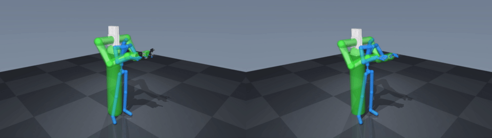

# Dual Kinova3 Teleoperation

## Shared Python dependencies

`geo_kin_core` and `xrt_devices` now come from versioned PyPI wheels, not Git
submodules. The tested versions for this checkout are:

```bash
python -m pip install "eurola-geo-kin-core==0.1.2" "eurola-xrt-devices==0.1.2"
```

Normal project installation (`uv sync` or `pip install` with the project and its
local robot/simulator dependencies) selects these versions automatically. Imports
and the `geo-kin-provision` command are unchanged. Other robot, simulator, and
hardware submodules remain where needed; `--recurse-submodules` below is for those.
The private `geo_kin` solver and its license are still supplied separately.

For shared-library development, explicitly install matching source checkouts with
`python -m pip install -e /path/to/geo_kin_core -e /path/to/XRT_devices` and run the
venv's Python directly. A subsequent `uv sync` restores the released packages.




Two Kinova Gen3 arms with **Robotiq 2F-85 V4** grippers or **Psyonic Ability** hands, using the original SEW-Geometric-Teleop models. Rust `geo_kin` handles retargeting and the SEW safety filter; `XRT_devices` supplies XR, MediaPipe and recorded motion. Both shared packages are installed as versioned PyPI wheels.

| Variant | Mustard replay | Ip Man replay |
| --- | --- | --- |
| Robotiq | [MP4](docs/media/robotiq_mustard.mp4) | [MP4](docs/media/robotiq_ipman.mp4) |
| Psyonic | [MP4](docs/media/psyonic_mustard.mp4) | [MP4](docs/media/psyonic_ipman.mp4) |

The preview shows Robotiq on the left and Psyonic on the right, recorded in TCP-focused mode. Blue is the captured human skeleton; green is the solver's safety geometry.

## Setup

```bash
git clone https://github.com/Euler-Rodrigues-Lab/dual_kinova3_teleop.git
cd dual_kinova3_teleop
uv sync
```

Python 3.10+ is supported. Solver wheels are selected explicitly with
`geo-kin-provision install`; `uv sync` only installs application dependencies
and preserves an existing provisioned selection. To select a registered full
wheel, use `uv run geo-kin-provision install --project .`.

The wheel in [`wheels/`](wheels/) is an optional **pose-only simulation demo**
for the parent vr_robosuite application. Opt in from that application using
`uv run geo-kin-provision install --project . --wheel external/dual_kinova3_teleop/wheels/geo_kin-0.1.0-cp310-abi3-manylinux_2_34_x86_64.whl`.
A valid covering dev license always unlocks full pose/TCP access without the
one-minute limit, including with the demo build. Unlicensed demo sessions share
a 60-second process deadline from first solve, with no automatic resume.
Redistribution, standalone use, and physical robot control are prohibited under
the [free demo license](wheels/FREE_DUAL_KINOVA3.md). Other license grants remain
separate. The wheel checksum accompanies it.

## MuJoCo replay

The standalone replay, live-input and hardware commands below require a
separate full-access license; the free demo grant covers vr_robosuite only.

The bundled recordings are byte-identical to the G1/RBY1/OpenArm samples: 600 frames for Ip Man and 843 for mustard, sampled at 60 Hz.

```bash
uv run python -m dual_kinova3_teleop.demos.replay_offline --sample ipman_roll
uv run python -m dual_kinova3_teleop.demos.replay_offline --sample picking_up_mustard --variant psyonic
```

Replay defaults to kinematic updates, the safety filter, a human overlay and hidden left/right MuJoCo panels. Use `--no-human-overlay` to hide the skeleton or `--no-safety-filter` to disable both filtering and safety visualization. The standalone CLI defaults to TCP-focused (EEF) retargeting for replay, live input and hardware; the parent vr_robosuite app defaults to pose mode. `--retarget-mode eef` is an alias for `--retarget-mode tcp`; both still use tracked elbows and the safety filter. Use `--retarget-mode pose` to restore pose-focused retargeting. `--limited` enables arm joint limits in simulation.

```bash
# Fast headless validation; --steps 0 plays the complete clip.
uv run python -m dual_kinova3_teleop.demos.replay_offline --headless --variant psyonic
# MP4 capture requires ffmpeg; EGL is useful on headless Linux.
MUJOCO_GL=egl uv run python -m dual_kinova3_teleop.demos.replay_offline \
  --headless --sample picking_up_mustard --variant psyonic --video mustard.mp4
```

For Robotiq TCP mode, the target origin is the thumb/index fingertip midpoint.
The thumb-to-index direction defines +Y; index MCP defines the orthogonalized
approach direction +Z, and +X = Y × Z. This targets the mounted grasp site
145 mm beyond the tool origin. Missing or degenerate landmarks hold that arm.

For Psyonic EEF/TCP mode, the TCP is the **index MCP joint**, on both the captured human hand and the mounted robot hand. Its robot offset is extracted from the original corrected Ability XMLs. Cyan marks the human index-MCP target; magenta marks the actual robot index MCP; a thin yellow line shows any residual. These markers share the human skeleton's capture-to-viewer transform and appear in both the live viewer and saved video. The overlay does not move the human target to hide reach or safety-filter errors. Missing index-MCP input holds that arm.

If a TCP target falls outside the arm's geometric reach, simulation can align the robot shoulder midpoint with the captured shoulder midpoint, but only when this reduces the reach violation. Use `--no-shoulder-fallback` to keep the simulation base fixed. This fallback is disabled for both hardware modes; neither physical arm bases nor hardware coordinates are shifted. Safety filtering and joint limits can still prevent exact target coincidence.

The index-MCP TCP and shoulder fallback require the updated `geo_kin` wheel; register a replacement build with `--replace`, then run `geo-kin-provision install` again.

Other input: `--frames recording.npz` or `--csv recording.csv`. Playback controls: `--playback-speed 0.5`, `--loop`, `--steps 300`, `--rate 60`. The viewer and video use the same capsule endpoints, radii and world transform.

## Live input

```bash
uv sync --extra devices
uv run dual-kinova3-teleop --device xr --variant psyonic
# Optional camera input:
uv sync --extra mediapipe
uv run dual-kinova3-teleop --device mediapipe --camera 0
```

XR uses the shared [XRT_devices](https://github.com/Euler-Rodrigues-Lab/XRT_devices) connection and recording workflow; default host/port are `0.0.0.0:8080`. `--record` enables its recorder.

## Hardware teleop and replay

Hardware is **off by default**. Both live input and recorded motion can use the hardware controller. First exercise the transport-free dry-run, which runs the same bounded velocity controller and Ability packet encoding:

```bash
uv run python -m dual_kinova3_teleop.demos.replay_offline \
  --sample picking_up_mustard --variant psyonic --hardware dry-run \
  --hardware-trace /tmp/kinova-commands.jsonl
```

For real hardware, install Kinova's Kortex Python SDK compatible with your controller firmware into `.venv`, plus serial support. The SDK is supplied separately, as in the source hardware scripts.

```bash
uv sync --extra devices --extra hardware
uv pip install --python .venv/bin/python /path/to/kortex_api.whl
export KORTEX_USERNAME=your_username
export KORTEX_PASSWORD=your_password

# XR -> two Gen3 arms and Robotiq grippers
uv run dual-kinova3-teleop --hardware live --variant robotiq \
  --left-ip 192.168.2.12 --right-ip 192.168.1.10

# Recorded motion -> two Gen3 arms and Psyonic Teensy controllers
uv run python -m dual_kinova3_teleop.demos.replay_offline \
  --hardware live --variant psyonic --sample picking_up_mustard \
  --left-ip 192.168.2.12 --right-ip 192.168.1.10 \
  --left-serial /dev/ttyACM1 --right-serial /dev/ttyACM0 --playback-speed 0.5
```

Live mode sends motion immediately when tracked input is available, starts from measured joint feedback, and does not home the arms. Verify the left/right network and serial assignments before using it. Real replay follows wall-clock time, including when headless. The source controller's gains are retained: Robotiq `kp=2`, Psyonic `kp=5`, both `kd=0.5`; wrapped joint error is converted to Kortex degrees/second and bounded by `--max-speed-deg` (default 20). Live mode requires the safety filter and enables arm joint limits.

The worker consumes the newest target, stops both arms on missing input, errors, shutdown or command expiry (`--command-timeout`, default 0.25 s), and rejects stale feedback. These are software stop requests, subject to transport/controller availability. Ability fingers hold their last commanded position when input stops; there is no automatic release. Keep the robot's physical emergency stop available.

Robotiq uses Kortex position commands for close/open. Psyonic uses the original 460800-baud Teensy protocol: six little-endian float32 degree targets in index/middle/ring/pinky/thumb-flexion/thumb-abduction order. The ten-joint simulated hand is mapped and clipped exactly as in the source controller.

## Model, wrist frames and safety geometry

`dual_kinova3_teleop/assets/provenance.json` records the source revision and hashes. The original robot XML and corrected left/right Ability XMLs are unchanged; `scripts/build_scenes.py` composes them with lighting and a floor. `scripts/generate_spec.py` extracts the public geometry specification. Source meshes and recordings are bundled so replay needs no SEW checkout.

The Psyonic wrist convention follows `rotation_matrix_kinova_EEF_to_standard_wrist` in the original hardware controller: right extrinsic `yx = [pi/2, -pi]`, left `yx = [pi/2, 0]`. Robotiq uses intrinsic `ZYX = [pi/2, 0, pi/2]` on both sides. The URDF end-effector convention is transferred into the exact MJCF tool frame; hand mounts are not approximated using G1 geometry.

The default safety profile is the hardware controller's `get_global_sew_geometry`:

| Capsule | Radius | Extent |
| --- | --- | --- |
| Torso | 0.15 m | body-frame z = 0 to -1.2 m |
| Shoulder | 0.07 m | left to right shoulder |
| Upper arm | 0.065 m | shoulder to elbow |
| Forearm | 0.065 m | elbow to wrist |
| Hand | 0.065 m | wrist to tool |

Arm lengths and shoulder spacing come from the exact dual-arm MJCF. The overlay reads all eight capsules directly from the active Rust filter, rather than maintaining a separate visual profile. These SEW proxies do not model detailed finger collisions or the environment. The older offline solver profile remains available in the private Python binding through `geometry_config='offline_reference', wrist_convention='offline_reference'` for numerical migration comparisons.

Reference routes in SEW-Geometric-Teleop:

- `projects/egoshift_dexmimicgen/demos/demo_robosuite_offline_robot_teleop.py`
- `projects/dual_kinova3_teleop/demo_dual_kinova3_xr_robot_teleop_hardware_teleop.py`
- `projects/dual_kinova3_teleop/controllers/sew_mimic_to_joint_position.py`
- `projects/psyonic_hand_teleop/demo_dual_kinova3_psyonic_xr_teleop_hardware.py`
- `projects/psyonic_hand_teleop/ability_hand/ability_hand_controller_teensy.py`

## Validation

```bash
uv sync --extra test
uv run pytest -q
```

Public tests cover asset hashes, joint mapping, overlay dimensions, hardware units/protocol, stale-command stops and transport failure. Private migration tests compare 200 arm cases and 120 session frames against the original Python solver, plus Psyonic hand streams from both clips at `1e-9` tolerance. Independent FK checks compare both variants with MuJoCo. Both complete clips have been rendered for both variants. For the Psyonic index-MCP update, independent full-clip FK checks measured at most 0.67 mm target error before safety filtering. With the hardware safety profile enabled, median TCP error is about 3 mm for Ip Man and below 0.01 mm for mustard; transient maxima are 22.2 cm and 3.4 cm respectively as filtering displaces the target. The target markers show these residuals. Hardware control is tested with dry-run/mocked transports; real robots and live XR have not been exercised.

Application code is MIT; original assets and submodules retain their respective terms. See [THIRD_PARTY_NOTICES.md](THIRD_PARTY_NOTICES.md). The solver wheel has its own license.
